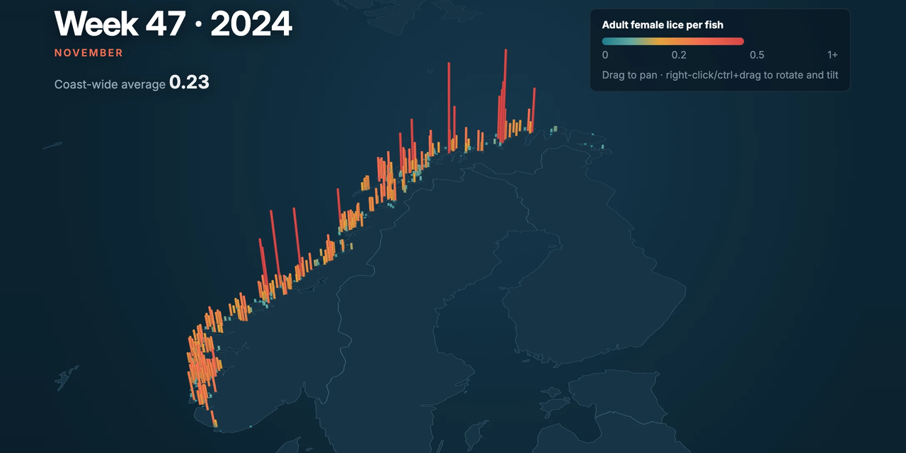

# Sea lice in Norwegian salmon farming – weekly brief and forecast on open data

**Live app: [lakselus.streamlit.app](https://lakselus.streamlit.app)** – updated automatically every week.

[](https://lakselus.streamlit.app)

How many adult female sea lice (*lakselus*) are on the salmon in Norway's fish farms, how does that
change through the year, and can the level be forecast 1–4 weeks ahead better than a simple rule of thumb?

The project pulls weekly lice counts from about 1,050 sites (2019 → today), aggregates them by
production area (*produksjonsområde*) and presents them in a Streamlit app built like a weekly
consulting report. The forecasts are evaluated honestly against naive baselines.

Built in **Python** (pandas, scikit-learn, Altair, pydeck/deck.gl, Streamlit). Independent portfolio
project – analysis of open data, not prepared for or by any company.

Developed with AI-assisted coding (Claude). Problem framing, methodology, model validation and all
design decisions are my own.

## The app – five pages

### 1. Latest week – weekly brief in consulting format
Structured like a report deliverable:

- **Action titles** that state the conclusion (e.g. *"Lice levels are 24% lower than a year ago – pressure is highest in Karmøy til Sotra"*). Titles and figures are computed from the data and update every week.
- **Executive summary** with three key findings: the coast-wide average, sites above the lice limit (*lusegrense*), and areas with a red traffic light (*trafikklyssystemet*). Each has a small chart (26-week trend against a year earlier, share above the limit, the 13 traffic lights) and an info bubble explaining the calculation.
- **Worth a look this week**: clickable cards for the highest count, the sharpest rise, the steepest fall and the fastest-rising area. Rows in the tables open the area or site as well.
- **Numbered exhibits** with units and sources:
  1. Map of sites and production areas (coloured by the government traffic light) and a ranking of the 13 areas against the lice limit.
  2. Status table by area: lice level, 4-week change, share of sites above the limit, sea temperature.
  3. Small multiples: the current year against the mean and range of previous years, by area.
  4. Seasonal heatmap: the peak comes later the further north you go.
- **Method and caveats** at the bottom. Conclusions only use areas with at least 10 sites; smaller areas are shown but flagged.
- **Find your area or site.** A search box at the top refocuses the brief on one production area or one fish farm
  (search by name or site number). The headline and key figures follow the choice, the map zooms in, the area is
  highlighted in the table and shown first in the small multiples. A chosen site also gets its own lice history
  against the lice limit (0.2 in the spring weeks) and a table of the sites within 20 km and how they are developing,
  i.e. the infection pressure from its neighbours. Clicking the map or a bar makes the same choice, and the choice is
  kept in the URL (`?po=3`, `?site=12345`), so a page can be bookmarked and shared.

### 2. History – 3D map week by week
A 3D map where every site is a column that grows with the lice count. Play the period from 2019 to
today and watch lice build up in late summer and fall again in winter. Includes a timeline, speed
control and the ability to rotate and tilt the map.

Playback runs entirely in the browser: ~1,000 sites × ~400 weeks are packed as one byte per value
(≈ 0.6 MB) and rendered with deck.gl. The coastline is drawn from Natural Earth, so no map API key is needed.

### 3. Forecast – what happens next, and how far to trust it
The page is split in two. First, for everyone: the 1–4 week forecast for the chosen area in plain language
(it opens on the area picked on the Latest week page), with an 80% range, and how much each treatment type
lowers lice compared with similar untreated sites. Then, for the technically curious: a comparison of eight
models (two naive benchmarks and six candidates), the gain by area and the backtest track in the test period, with info bubbles explaining MAE, skill
and the Diebold–Mariano test.

### 4. Currents – how the water moved in the same week
Sea lice larvae drift with the water for days before they can attach to a fish. This page animates the daily mean
surface current along the coast for the week of the latest lice counts, with every farm coloured by its lice level.
Thousands of particles follow the current in the browser (deck.gl and a canvas), so the Norwegian Coastal Current and
its eddies become visible. The particles are water, not lice: the page says so, and points to the Institute of Marine
Research's official infection-pressure model for where larvae actually end up.

The currents come from MET Norway's NorKyst v3 ocean model (800 m) over OPeNDAP, read with plain `requests` and
numpy. Seven daily means (every third hour) are regridded to about 3 km in Web Mercator and packed as one byte per
value (≈ 0.9 MB for the whole coast).

### 5. About – data, methods and changes
One place for everything a critical reader wants to know: where the data come from and how they are processed,
how the forecast is built and tested (with the current test figures computed from the backtest), how the
treatment-effect study works, what the figures cannot tell you, and a changelog of every change that affects the
figures.

An **About** section at the bottom of every page sums up who built it, the data, the method and the code.

## Models and evaluation

Eight models are backtested week by week (expanding window, retrained every quarter). Every forecast is
made **only with the data available at the time** – tested automatically by corrupting all future data
and checking that the forecasts are unchanged.

| Model | Idea |
|---|---|
| Naive | Last week's level |
| Seasonal naive | Same week last year |
| Naive + seasonal change | Last level + the area's typical change for the time of year |
| Ridge regression | Direct model per horizon on the change y(t+h) − y(t) |
| Gradient boosting | Same target, non-linear, MAE loss, pooled across areas |
| Gradient boosting + treatments | As above, plus the share of the area's sites treated against lice |
| **Gradient boosting + lice stages** | As above, plus the younger lice stages (attached and mobile lice per fish) |
| Ensemble | Mean of naive + seasonal change, ridge and gradient boosting |

Features: level and changes over 1–8 weeks, rolling mean and spread, sea temperature, ISO week
(sine/cosine), the area's seasonal profile, number of sites, and the coast-wide trend. The seasonal
profile is computed leave-one-out: a training row only sees the same week's change in *other* years, so
it never contains its own target.

**Discipline:** Models and settings were selected on **2023–24** (validation). The results below are
from **2025 onwards** (test), which was not used for any choice. Figures as of week 44, 2026 – they move
slightly each week as new weeks and late corrections arrive; the app always shows the current values.

| Test period 2025→ | 1 week | 2 weeks | 3 weeks | 4 weeks |
|---|---|---|---|---|
| MAE naive | 0.023 | 0.032 | 0.040 | 0.045 |
| MAE gradient boosting + lice stages | **0.020** | **0.025** | **0.029** | **0.032** |
| Skill vs. naive | +12% | +22% | +27% | +29% |
| Diebold–Mariano p | < 0.001 | < 0.001 | < 0.001 | < 0.001 |
| 80% interval coverage | 80% | 80% | 80% | 79% |

Gradient boosting with lice stages has the lowest error at every horizon, and its improvement over the naive
forecast is statistically significant throughout (the other learning models also beat the naive forecast, but by less). The gain grows with the horizon: the naive
forecast is hard to beat one week ahead, but the model captures seasonality and momentum, which matter
more further out. The prediction intervals (empirical quantiles of the model's own past errors by area)
are well calibrated.

Reproduce the figures with `python -m lakselus.modelrapport` (a few minutes).

**Lice treatments:** One candidate also uses the share of an area's sites treated against lice that week
and over the past four weeks (mechanical, thermal, freshwater and medicinal treatments, from the
BarentsWatch treatment export). On the validation period it did not beat gradient boosting without
treatments (skill 13.0% vs. 13.5% at two weeks; Diebold–Mariano p > 0.05 at every horizon). Farms treat
when lice counts are high, and the model already sees the lice history. In the test period it came out
marginally ahead (skill 27.7% vs. 26.9% at four weeks), but the model is chosen on validation only, so that
does not change the selection. The candidate stays in the weekly backtest, so the model choice will pick it
up if treatments start to add information on the validation period's terms.

**Lice stages:** Farms also count the younger stages – attached and mobile lice per fish – which grow
into adult females over the following weeks. Adding them (plus the two-week change in mobile lice) raised
gradient boosting's skill on the validation period from 16.9% to 18.7% averaged over the horizons
(Diebold–Mariano p < 0.01 one and two weeks ahead), so it became the selected model. In the test period
the gain held: skill one week ahead rose from 8% to 12%, and the difference to gradient boosting without
stages is significant at every horizon. Sea temperature summed over 4–8 weeks (degree-days), neighbouring
areas' lice levels and how far farms are into their production cycle were tested the same way and gave
no reliable gain.

**What treatments do:** The Forecast page also shows an event study of single, whole-site treatments:
the lice level week by week around a treatment, compared with untreated sites that had the same lice level
in the same month. Thermal and mechanical treatments remove most lice within a week, bath treatments work
over a few weeks, and in-feed treatments mainly stop growth. Computed in `behandlingseffekt.py`.

**Caveats:** Treatments explain some of the abrupt drops but cannot be known ahead of time. Data are
retrieved as they look today; late corrections were not necessarily known in the forecast week.

## Data

- **Source:** [BarentsWatch Fishhealth API](https://www.barentswatch.no/bwapi/openapi/) – the bulk export
  of weekly lice counts per site with sea temperature and production area, the export of lice
  treatments per site and week, plus production-area boundaries and traffic lights.
- **Licence:** NLOD (Norwegian Licence for Open Government Data). Data delivered by BarentsWatch;
  information about lice and treatments is provided by the Norwegian Food Safety Authority (Mattilsynet).
- **Ocean currents:** [NorKyst v3](https://thredds.met.no/thredds/dodsC/fou-hi/norkystv3_800m_m00_be.html), the
  coastal ocean model of the Norwegian Meteorological Institute (MET Norway), under CC BY 4.0 / NLOD. No key needed.
- **Processing:** Area figures are unweighted means over sites that counted lice that week (the number of
  fish per site is not in the dataset). The latest week is only included once at least 80% of sites have
  reported.

## Getting started

1. Create a user and an API client at <https://www.barentswatch.no/minside/> (choose **API client**).
   The client id has the form `you@example.com:clientname`.
2. Copy `.env.example` to `.env` and fill in `BW_CLIENT_ID` and `BW_CLIENT_SECRET`.
   `.env` is in `.gitignore` and must never be committed.
3. Install, fetch data and start the app:

```bash
python3 -m venv .venv && source .venv/bin/activate
pip install -e ".[dev]"
python -m lakselus.hent --fra 2019
streamlit run app.py
```

Run the tests with `pytest`.

## Hosting and weekly updates

The app runs for free on **Streamlit Community Cloud** and needs no API key there: it reads compact,
pre-processed data from `data/app/` (≈ 2 MB, committed to the repo), including the finished backtest.

A **GitHub Action** (`.github/workflows/ugentlig-opdatering.yml`) runs every Wednesday: it fetches new
lice counts, treatments and the week's ocean currents, re-runs the models, publishes `data/app/`, runs all tests as a quality gate and pushes.
Streamlit Cloud redeploys automatically on every push. The workflow needs the repository secrets
`BW_CLIENT_ID` and `BW_CLIENT_SECRET`; without them it is skipped.

To refresh the published data manually:

```bash
python -m lakselus.hent --fra 2019
python -m lakselus.havstroem
python -m lakselus.modelrapport
python -m lakselus.publicer
```

## Structure

The code uses Danish identifiers and comments (the author is Danish); the app and this README are in English.

```
app.py                     navigation and shared layout
sider/
  oversigt.py              Latest week: search, summary, exhibits, method
  tidsmaskine.py           History: 3D map played week by week
  prognose.py              Forecast: forecast and treatment effects, then model evaluation
  havstroem.py             Currents: animated surface currents with the week's lice counts
  om.py                    About: data, methods, limitations and changelog
src/lakselus/
  barentswatch.py          API client (OAuth2 client credentials)
  hent.py                  fetches raw data into a local cache
  data.py                  data preparation: weekly panel by area
  evaluering.py            baselines, backtest, MAE/skill, Diebold–Mariano, intervals
  modeller.py              features and model candidates (ridge, gradient boosting with treatments or lice stages, ensemble)
  modelrapport.py          full backtest, selection on validation, report on test
  behandlingseffekt.py     event study of how much each treatment type lowers lice counts
  publicer.py              writes compact app data to data/app for hosting
  appdata.py               cached lookups and key figures for the app
  tidsmaskine.py/.html     data packing and deck.gl view
  havstroem.py/.html       NorKyst v3 currents over OPeNDAP, regridding, packing and the particle map
  udseende.py              design system: colours, typography, exhibits, Altair theme
analyse/                   notebook with data preparation and baselines
data/app/                  compact data and backtest used by the hosted app (in git)
data/raw/                  local cache of raw data (not in git)
.github/workflows/         weekly data and model update
tests/
```

## Author and licence

Built by [Martin Eckberg Bindner](https://www.linkedin.com/in/martin-eckberg-bindner-872207422), data analyst,
with an AI coding assistant. The code is released under the [MIT licence](LICENSE). The data belong to
BarentsWatch / the Norwegian Food Safety Authority and are used under NLOD.
