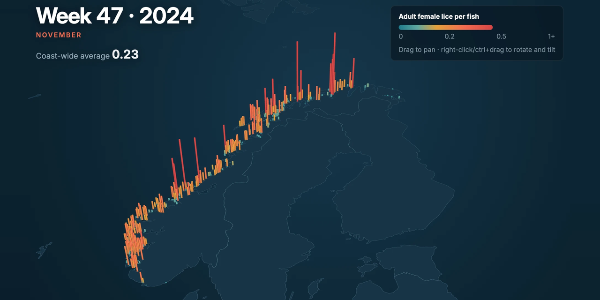

# Sea lice in Norwegian salmon farming – weekly brief and forecast on open data

**Live app: [lakselus.streamlit.app](https://lakselus.streamlit.app)** – updated automatically every week.

[](https://lakselus.streamlit.app)

How many adult female sea lice (*lakselus*) are on the salmon in Norway's fish farms, how does that
change through the year, and can the level be forecast 1–4 weeks ahead better than a simple rule of thumb?

The project pulls weekly lice counts from more than 1,200 sites (2019 → today), aggregates them by
production area (*produksjonsområde*) and presents them in a Streamlit app built like a weekly
consulting report. The forecasts are evaluated honestly against naive baselines.

Built in **Python** (pandas, scikit-learn, Altair, pydeck/deck.gl, Streamlit). Independent portfolio
project – analysis of open data, not prepared for or by any company.

## The app – three pages

### 1. Overview – weekly brief in consulting format
Structured like a report deliverable:

- **Action titles** that state the conclusion (e.g. *"Lice levels are 24% lower than a year ago – pressure is highest in Karmøy til Sotra"*). Titles and figures are computed from the data and update every week.
- **Executive summary** with three key findings: the coast-wide average, sites above the lice limit (*lusegrense*), and areas with a red traffic light (*trafikklyssystemet*).
- **Numbered exhibits** with units and sources:
  1. Map of sites and production areas (coloured by the government traffic light) and a ranking of the 13 areas against the lice limit.
  2. Status table by area: lice level, 4-week change, share of sites above the limit, sea temperature.
  3. Small multiples: the current year against the mean and range of previous years, by area.
  4. Seasonal heatmap: the peak comes later the further north you go.
- **Method and caveats** at the bottom. Conclusions only use areas with at least 10 sites; smaller areas are shown but flagged.

### 2. Time machine – 3D map week by week
A 3D map where every site is a column that grows with the lice count. Play the period from 2019 to
today and watch lice build up in late summer and fall again in winter. Includes a timeline, speed
control and the ability to rotate and tilt the map.

Playback runs entirely in the browser: ~1,000 sites × ~400 weeks are packed as one byte per value
(≈ 0.6 MB) and rendered with deck.gl. The coastline is drawn from Natural Earth, so no map API key is needed.

### 3. Forecast – model selection and honest evaluation
Same consulting format: a summary of the test result, a 1–4 week forecast with an 80% interval for
the selected area, a comparison of six models, the gain by area and the backtest track in the test period.

## Models and evaluation

Six models are backtested week by week (expanding window, retrained every quarter). Every forecast is
made **only with the data available at the time** – tested automatically by corrupting all future data
and checking that the forecasts are unchanged.

| Model | Idea |
|---|---|
| Naive | Last week's level |
| Seasonal naive | Same week last year |
| Naive + seasonal change | Last level + the area's typical change for the time of year |
| Ridge regression | Direct model per horizon on the change y(t+h) − y(t) |
| **Gradient boosting** | Same target, non-linear, MAE loss, pooled across areas |
| Ensemble | Mean of the three above |

Features: level and changes over 1–8 weeks, rolling mean and spread, sea temperature, ISO week
(sine/cosine), the area's seasonal profile, number of sites, and the coast-wide trend.

**Discipline:** Models and settings were selected on **2023–24** (validation). The results below are
from **2025 onwards** (test), which was not used for any choice. Figures as of week 42, 2026 – they move
slightly each week as new weeks and late corrections arrive; the app always shows the current values.

| Test period 2025→ | 1 week | 2 weeks | 3 weeks | 4 weeks |
|---|---|---|---|---|
| MAE naive | 0.023 | 0.032 | 0.040 | 0.045 |
| MAE gradient boosting | **0.022** | **0.028** | **0.032** | **0.035** |
| Skill vs. naive | +5% | +12% | +19% | +23% |
| Diebold–Mariano p | 0.029 | 0.001 | < 0.001 | < 0.001 |
| 80% interval coverage | 81% | 80% | 78% | 78% |

Gradient boosting is the only model that beats the naive forecast at all four horizons, and the
improvement is statistically significant throughout. The gain grows with the horizon: the naive
forecast is hard to beat one week ahead, but the model captures seasonality and momentum, which matter
more further out. The prediction intervals (empirical quantiles of the model's own past errors by area)
are well calibrated.

Reproduce the figures with `python -m lakselus.modelrapport` (a few minutes).

**Caveats:** Lice treatments are not included as an explanatory variable and account for some of the
abrupt drops. Data are retrieved as they look today; late corrections were not necessarily known in the
forecast week.

## Data

- **Source:** [BarentsWatch Fishhealth API](https://www.barentswatch.no/bwapi/openapi/) – the bulk export
  of weekly lice counts per site with sea temperature and production area, plus production-area
  boundaries and traffic lights.
- **Licence:** NLOD (Norwegian Licence for Open Government Data). Data delivered by BarentsWatch;
  information about lice is provided by the Norwegian Food Safety Authority (Mattilsynet).
- **Processing:** Area figures are unweighted means over sites that counted lice that week (the number of
  fish per site is not in the dataset). The latest week is only included once at least 80% of sites have
  reported.

## Getting started

1. Create a user and an API client at <https://www.barentswatch.no/minside/> (choose **API client**).
   The client id has the form `you@example.com:clientname`.
2. Copy `.env.example` to `.env` and fill in `BW_CLIENT_ID` and `BW_CLIENT_SECRET`.
   `.env` is in `.gitignore` and must never be committed.
3. Install, fetch data and start the app:

```bash
python3 -m venv .venv && source .venv/bin/activate
pip install -e ".[dev]"
python -m lakselus.hent --fra 2019
streamlit run app.py
```

Run the tests with `pytest`.

## Hosting and weekly updates

The app runs for free on **Streamlit Community Cloud** and needs no API key there: it reads compact,
pre-processed data from `data/app/` (≈ 2 MB, committed to the repo), including the finished backtest.

A **GitHub Action** (`.github/workflows/ugentlig-opdatering.yml`) runs every Wednesday: it fetches new
lice counts, re-runs the models, publishes `data/app/`, runs all tests as a quality gate and pushes.
Streamlit Cloud redeploys automatically on every push. The workflow needs the repository secrets
`BW_CLIENT_ID` and `BW_CLIENT_SECRET`; without them it is skipped.

To refresh the published data manually:

```bash
python -m lakselus.hent --fra 2019
python -m lakselus.modelrapport
python -m lakselus.publicer
```

## Structure

The code uses Danish identifiers and comments (the author is Danish); the app and this README are in English.

```
app.py                     navigation and shared layout
sider/
  oversigt.py              Overview: summary, exhibits 1–4, method
  tidsmaskine.py           Time machine: 3D map played week by week
  prognose.py              Forecast: model comparison and backtest by area
src/lakselus/
  barentswatch.py          API client (OAuth2 client credentials)
  hent.py                  fetches raw data into a local cache
  data.py                  data preparation: weekly panel by area
  evaluering.py            baselines, backtest, MAE/skill, Diebold–Mariano, intervals
  modeller.py              features and model candidates (ridge, gradient boosting, ensemble)
  modelrapport.py          full backtest, selection on validation, report on test
  publicer.py              writes compact app data to data/app for hosting
  appdata.py               cached lookups and key figures for the app
  tidsmaskine.py/.html     data packing and deck.gl view
  udseende.py              design system: colours, typography, exhibits, Altair theme
analyse/                   notebook with data preparation and baselines
data/app/                  compact data and backtest used by the hosted app (in git)
data/raw/                  local cache of raw data (not in git)
.github/workflows/         weekly data and model update
tests/
```

## Author and licence

Built by [Martin Eckberg Bindner](https://www.linkedin.com/in/martin-eckberg-bindner-872207422), data analyst,
with an AI coding assistant. The code is released under the [MIT licence](LICENSE). The data belong to
BarentsWatch / the Norwegian Food Safety Authority and are used under NLOD.
